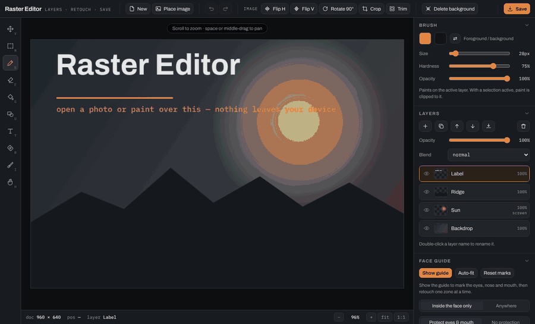
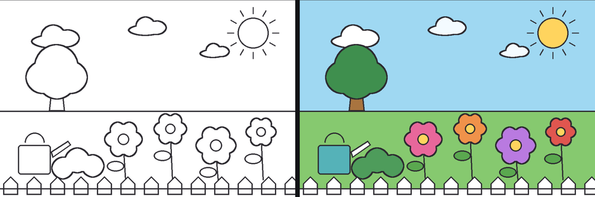
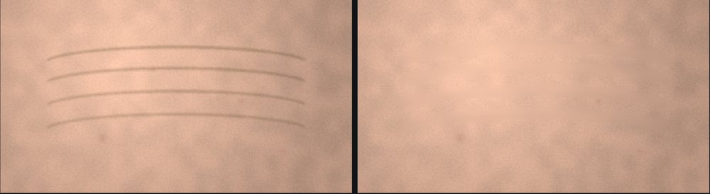

# Raster Editor

A layer-based image editor with portrait retouching that runs entirely in your browser.
One HTML file, no build step, no dependencies to install, no account, no server. Images
are opened and edited in memory and never uploaded anywhere — which is also why the whole
thing keeps working with the network switched off.

**Try it: [raster-editor.netlify.app](https://raster-editor.netlify.app/)**



---

## Features

- **Layers** — add, duplicate, reorder, merge down, delete; per-layer opacity and all 16
  canvas blend modes; rename by double-clicking; live thumbnails.
- **Paint** — brush and eraser with size, hardness and opacity; flood fill with a
  tolerance; rectangle, ellipse, line and triangle shapes; text; eyedropper.
- **Portrait retouch** — heal, smooth and clone brushes, plus whole-layer skin smoothing
  that leaves eyes, lips, brows and hair sharp.
- **Face guide** — a box with marks on the eyes, nose and mouth that decides where
  retouching may go, and drives one-click work on the forehead, under-eyes, cheeks,
  nose-to-mouth folds and chin.
- **Cut-outs** — remove the editor's own canvas in one click, or lift a photo's backdrop
  with a magic eraser that has adjustable tolerance and feathering.
- **Selections** — a rectangular marquee that clips painting, retouching, fills, text and
  adjustments; crop the document to it.
- **Adjustments** — brightness, contrast, saturation, hue, blur, sepia, grayscale and
  invert, previewed live, plus auto levels.
- **Opens iPhone photos** — HEIC and HEIF decode in the browser, with the decoder bundled
  so it works offline.
- **Saves** PNG, JPEG or WebP at 0.5×, 1× or 2×, named after the image you opened.
- **Works on a phone** — pinch to zoom, two fingers to pan, finger-sized controls.

Every tool's settings appear in the panel on the right as you pick it, and they stay
where you put them. Nothing in the app moves a slider you set.

---

## Colouring and editing

The demo above colours in `demo/garden.png` with the paint bucket, one region per click,
then lifts the result with the saturation slider and saves it.



Open an image with **Place image**, drag it onto the canvas, or paste with `Ctrl+V`. HEIC
straight off an iPhone works. The sample images are drawn by `tools/make-samples.py`; no
photographs are included.

---

## Retouching skin



The sample above is `demo/skin.png`, generated with creases, blotchy tone and pore
texture. Four strokes with the heal brush remove the lines while the pores and the uneven
tone survive.

### 1. Heal the individual lines

Press `R` and leave the brush in **Heal**. Size it a little wider than the line you are
removing — wide enough to cover the crease and a sliver of clean skin, not the whole
cheek. `[` and `]` resize as you go.

Paint a short stroke along each crease: forehead lines, the two vertical lines between the
brows, crow's feet, the folds from nose to mouth corners, and any blemishes. Short strokes
beat one long one, because undo then costs millimetres.

Underneath, the shading inside the brush is replaced with skin interpolated from a ring of
40 samples taken around it, and the original pore texture is laid back over the patch.
That is why the result still looks like skin rather than a smeared thumbprint.

If a stroke near an eyelid or nostril smears, undo and use **Clone**: Alt-click to set a
source on clean skin, then paint. Clone copies pixels verbatim, so it holds up beside a
hard edge where heal does not.

### 2. Mark the face, then retouch by zone

On a portrait, the face guide takes over from freehand strokes. Open **Face guide** and
press **Show guide**, or **Auto-fit** to drop the box over the largest skin-coloured area.
Drag the corners to frame the face, the top-centre dot to move it, and the four blue marks
onto the eyes, nose and mouth.

This is a guide you place, not a face detector. A detector means shipping neural-network
weights and fetching them at runtime, and this editor is built to run with the network
off. Auto-fit finds the largest skin-coloured blob and the marks start at standard
proportions; you move them onto the real features.

Each mark sizes on its own — drag the green square beside it, or use the four sliders.
Cover the lids and lashes with the eye zones, the lips with the mouth zone, and shrink the
nose zone until it just covers the nostrils. The white diamond drags all four marks
together, and they stay inside the rectangle.

Two switches decide where retouching may go, and they apply to the brush and the Portrait
panel as well as the zone buttons:

- **Inside the face only** confines every retouch operation to the oval.
- **Protect eyes & mouth** punches the blue zones out of it, so eyes, nostrils and lips
  cannot be softened even by a stroke painted across them.

The six zone buttons then retouch one area at a time. Each uses the operation that suits
it: **Forehead**, **Under-eyes** and **Nose to mouth** run heal strokes, because those
zones are creases; **Cheeks**, **Chin & jaw** and **Whole face** smooth instead, because
those are texture and blotchiness. Strength comes from the Retouch brush's slider.

That split matters. Running heal across a whole cheek rebuilds the shading patch by patch
from each brush's surroundings, and the overlapping patches blotch and drag the skin
visibly darker — 40 levels of drift, measured, before the zones were split by operation.
Smoothing keeps the shading it finds.

### 3. Even out the skin

**Portrait retouch** smooths a whole layer at once.

- **Smoothing** sets the amount. The other three shape an effect it switches on, so at 0%
  they have nothing to act on and the panel says so.
- **Radius** scales with how large the face sits in the frame — 4–8 for head-and-
  shoulders, higher for a close-up.
- **Keep pores** controls how much texture survives; below about 25% skin turns plastic.
- **Edge guard** protects detail stronger than its threshold, which keeps lashes, lips,
  nostrils, brows and hair out of the blur. It scales with Radius, so raising one does not
  quietly weaken the other.
- **Skin tones only** leaves background, clothing and hair alone.

**Apply** bakes the preview into the pixels; **Reset** discards it and returns the sliders
to their defaults. With a selection active it only touches what is inside.

### 4. Dial it back

Full-strength smoothing looks artificial on a real photograph. Duplicate the layer, smooth
the copy, Apply, then drop that layer's **Opacity** to 60–80% so some original skin shows
through. Heal the individual lines on the layer underneath first — those should go away
completely rather than fade back in.

### How it works

Both tools split the pixels into a **low frequency** part — a blur holding shading,
blotches and the shadow a wrinkle casts — and a **detail** part, the original minus the
low, holding pores and grain. Skin faults live in the low part and skin realism lives in
the detail part, so the code rebuilds the low part and puts the original detail back on
top. Heal goes further and replaces the low part with a field interpolated from the ring
around the brush, which deletes a line instead of blurring it. Skin detection uses the
standard YCbCr chroma window, feathered so the mask has no visible border.

Measured on a synthetic test: a wrinkle at 54 levels of contrast drops to 12 after one
heal stroke while pore texture keeps about half its variance, and a hard edge at 172
levels is unchanged after 75% whole-layer smoothing.

---

## Two kinds of background

**Delete background** in the toolbar removes what the *editor* put on the canvas: the
sample artboard it opens with, or the white canvas **New** creates. It then trims the
document to what is left, so saving gives you your picture and your edits and nothing
else. It never touches an image you placed or a layer you have drawn on — editing a layer
makes it yours, and the button stops treating it as background from that moment.

**The magic eraser** removes an image's *own* backdrop, the studio wall behind a subject.
Press `E`, switch to **Magic**, then either click a colour to erase it or press **Remove
background** to flood inward from the edges.

Tolerance is the control that matters. Start low and raise it until the backdrop goes in
one click; if the subject starts disappearing, it has gone too far. The limit is the
image, not the slider: where a subject is genuinely close in colour to its backdrop,
nothing separates them and that part needs the ordinary brush eraser. **Feather** softens
the cut edge so the result does not look scissored.

### Saving with transparency

Transparency is carried by the file format, so save **PNG or WebP**. JPEG has no alpha
channel and fills every transparent pixel with white.

The grey chequerboard is transparency. If a colour still shows behind the subject after
erasing, something opaque is underneath — hide that layer with its eye icon. **Trim** then
crops away the empty margin.

The save name follows the image you opened with a `1` on the end, so the original is never
overwritten: `beach.jpg` becomes `beach1`. A name already ending in a digit gets a hyphen,
so `IMG_4821` becomes `IMG_4821-1` rather than `IMG_48211`. Type your own and it stops
being filled in for you.

---

## iPhone photos: HEIC in, but not out

Drop a `.heic` or `.heif` straight in. No browser except Safari decodes the format, so the
editor tries the browser first and falls back to a bundled decoder
(`vendor/heic2any.min.js`, about 1.3 MB of asm.js). It loads only when a HEIC turns up,
and because it ships with the site rather than coming from a CDN it works offline.

**Saving as HEIC is not possible**, here or in any other web app. Writing the format needs
an HEVC encoder, which no browser ships and which is patent-encumbered. Save **WebP**
instead: smaller than JPEG at the same quality, it keeps transparency, and iOS 14+ opens
it.

There is a trap behind this worth knowing. `canvas.toBlob` does not fail when asked for a
type it cannot encode — it quietly returns a **PNG**. Ask for `image/heic` and you get PNG
bytes that would land on disk under a `.heic` name. So the editor probes every candidate
format once at startup, keeps only the ones the browser honours, and re-checks the blob's
type before saving. If a browser ever ships a HEIC encoder, its button appears by itself.

---

## On a phone

- **Pinch to zoom, two fingers to pan.** A second finger mid-stroke cancels that stroke
  rather than smearing it.
- **The toolbar wraps** instead of scrolling sideways, and secondary actions become icons,
  so no button hides off-screen.
- **Controls are finger-sized** — 44px minimum on touch devices.
- **Most panels start collapsed** so the canvas is not pushed off the screen. Above phone
  width the panel stays on the right.
- **Large images are scaled on import** — 12 megapixels on a phone, 30 on a desktop. A
  24-megapixel photo with a full undo history would otherwise need hundreds of megabytes.

---

## Privacy and security

- **No image leaves the browser.** No server, no upload, no analytics, no telemetry.
  `connect-src 'none'` in `netlify.toml` makes the browser enforce that rather than asking
  anyone to trust it.
- **No third-party requests at all.** Fonts and the HEIC decoder are served from this
  folder, so nothing contacts Google or a CDN and no visitor IP is handed to anyone.
- **Saved files carry no metadata.** Re-encoding through a canvas drops EXIF, so GPS
  coordinates and camera serial numbers in the original do not reach the saved file.
- **Headers** set `nosniff`, `no-referrer`, `frame-ancestors 'none'` and `X-Frame-Options:
  DENY`, `base-uri` and `form-action` to `'none'`, and a `Permissions-Policy` that turns
  off camera, microphone, geolocation and payment.
- **One deliberate loosening:** `script-src` includes `'unsafe-eval'`, because libheif is
  compiled to asm.js and browsers refuse to run it otherwise. No input reaches `eval`, and
  with `connect-src 'none'` nothing could be sent anywhere regardless. Dropping
  `vendor/heic2any.min.js` and that directive together removes it, at the cost of HEIC
  support.
- **Text is escaped** before it reaches the page, and save filenames have path separators
  and control characters stripped.
- **Failures are visible.** A corrupt file, an unsupported format, a stalled decode or a
  document too large to allocate each produce a message rather than a hang or a silent
  no-op.

---

## Running it locally

Clone the repository and open **`index.html`** in a browser. That is the whole install —
it works immediately in Chrome, Edge, Firefox and Safari. On Windows, `run.bat` opens it
in the default browser.

A local server is only needed if the code is split into separate `.js` / `.css` files,
which `file://` restricts:

```bash
python -m http.server 8000     # then open http://localhost:8000
```

---

## Keyboard

| Key | Tool | | Key | Action |
|-----|------|---|-----|--------|
| `V` | Move | | `[` `]` | Brush size |
| `M` | Rectangular select | | `X` | Swap colours |
| `B` | Brush | | `Ctrl+Z` | Undo |
| `E` | Eraser / magic eraser | | `Ctrl+Shift+Z` | Redo |
| `G` | Fill | | `Ctrl+A` | Select all |
| `U` | Shape | | `Ctrl+D` | Deselect |
| `T` | Text | | `Del` | Clear selection |
| `R` | Retouch | | `Ctrl+0` | Fit to window |
| `I` | Eyedropper | | `Ctrl+V` | Paste an image |
| `H` | Pan (or hold space) | | Alt-click | Set clone source |

## Limitations

- **Undo depth scales with document size** — up to 14 steps, fewer on a large image, since
  each step holds a copy of every changed layer.
- **Selections are rectangles only** — no lasso, no magic wand, no feathering.
- **Text rasterizes when placed**, so the wording cannot be edited afterwards.
- **No layer masks**, so erasing is destructive. Duplicate a layer before a big edit.
- **No project file.** Closing the tab loses the layer stack; save before leaving.
- **HEIC is read-only.** PNG, JPEG and WebP are what can be written.
- **Cut-outs are colour-based**, like any magic wand — there is no subject detection.
- **The face guide is placed by hand.** Auto-fit is a skin-colour heuristic and will be
  fooled by hands, necks and wooden furniture.
- **Retouching large images is CPU-bound.** Whole-layer smoothing runs on the main thread,
  so a very large photo hitches while a slider moves.

## Repository layout

```
index.html            the entire application
netlify.toml          publish settings and security headers
run.bat               opens index.html on Windows
demo/                 sample images used by the demo and the examples
docs/                 images referenced by this README
tools/                sample generator and the scripts that record the demo
vendor/               bundled HEIC decoder and self-hosted fonts, with licences
```

Everything is in `index.html` — markup, styles and about 1,600 lines of plain JavaScript
with no framework. Sections are commented in the order they run: state, canvases, layers,
history, compose, render, tools, pointer handling, shapes, text, bucket, magic erase,
layer ops, adjustments, retouch, face guide, image ops, file I/O, save and keyboard.

Each layer is its own `<canvas>` at document resolution. On every frame they are
composited onto a hidden canvas using `globalCompositeOperation` for blend modes, and that
composite is drawn once into the visible canvas at the current zoom and pan. Brush strokes
go to a separate buffer first, so a stroke is previewed at full opacity and committed in
one pass — which is what stops a semi-transparent brush from darkening where it crosses
itself.

The demo GIF and the example images are produced by driving the real editor in a headless
browser, so they cannot drift out of date with the code. `tools/make-samples.py` draws the
samples, `tools/record-demo.mjs` and `tools/record-retouch.mjs` record the sessions, and
`tools/build-gif.py` and `tools/build-retouch.py` assemble the results.

## License

Apache License 2.0 — see [LICENSE](LICENSE) and [NOTICE](NOTICE).

Bundled third-party components keep their own licences: heic2any under MIT, and Archivo,
IBM Plex Mono and Playfair Display under the SIL Open Font License 1.1. Copies are in
`vendor/`.
